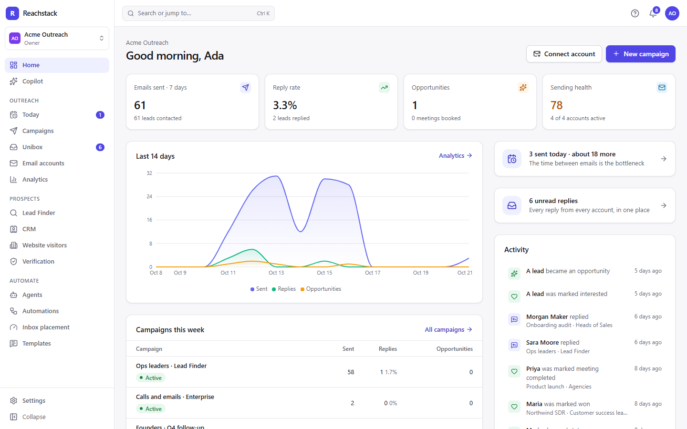
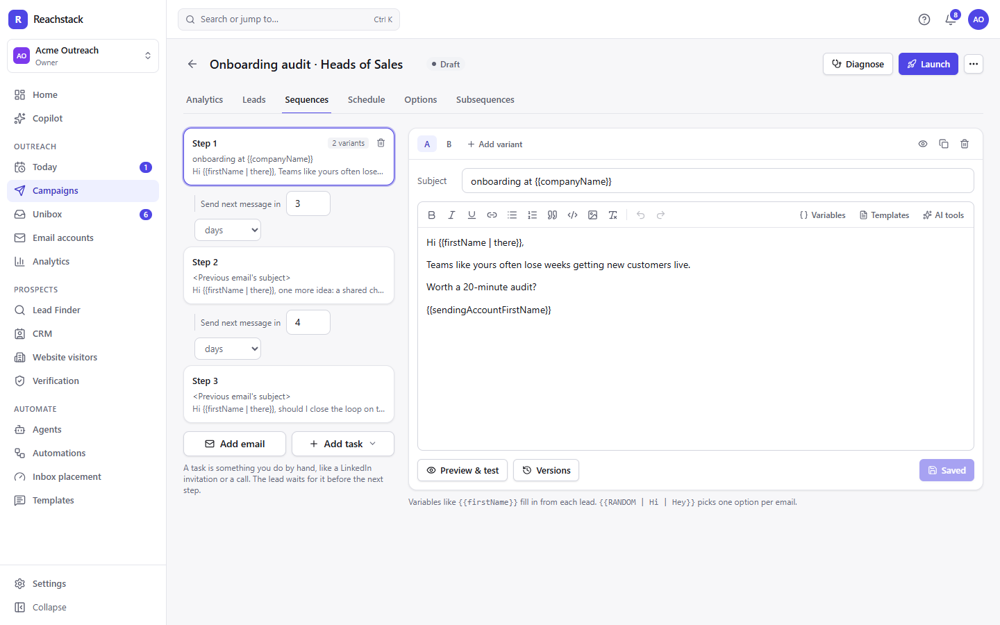
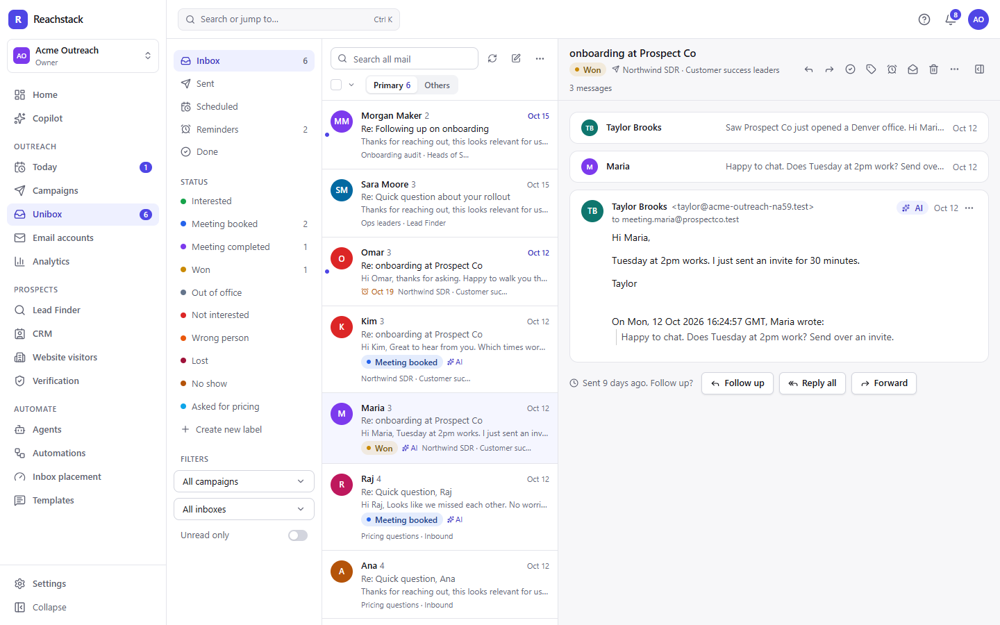
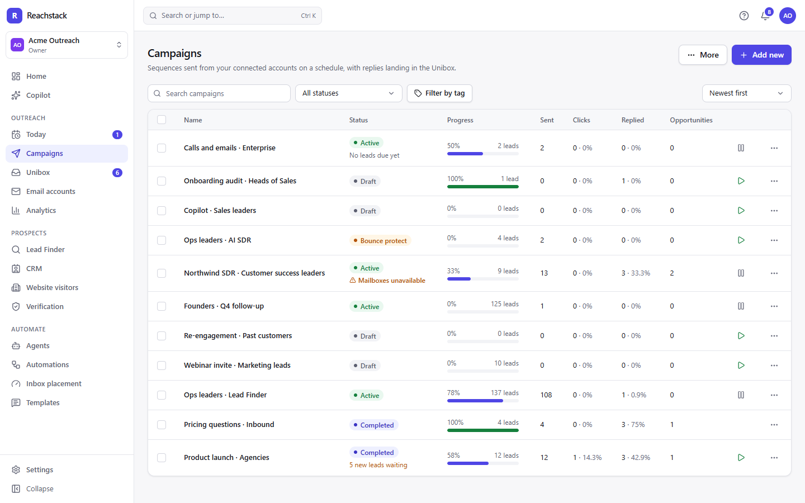
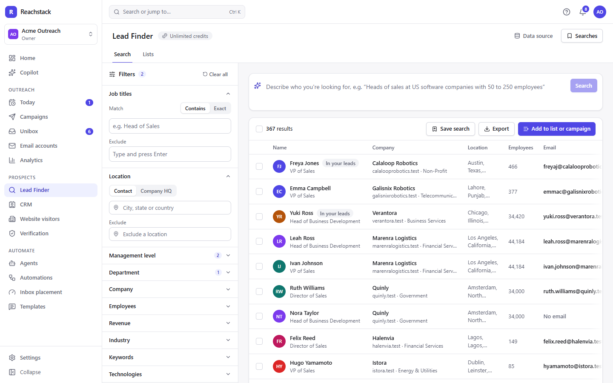

# Reachstack

**Self-hosted cold email outreach.** Connect your mailboxes, warm them up, run multi-step campaigns and answer every
reply from one inbox, on your own computer or your own server. No subscription and no per-seat pricing, and your
data stays with you.

> [!NOTE]
> **Reachstack is new.** It's checked by hundreds of automated tests and a fresh start on Linux, macOS and Windows,
> all with test mailboxes and stand-ins for outside services. Sending through real Gmail and Outlook mailboxes, Google
> and Microsoft sign-in, Stripe, Twilio and the AI features with a real AI haven't been used in the wild yet: start
> with one or two mailboxes and low daily limits, and [open an issue](https://github.com/Coder-ux-coder/reachstack/issues)
> when something isn't right.



## What it does

- **Email accounts and warmup.** Connect as many Google, Microsoft or IMAP/SMTP mailboxes as you like. Each keeps its
  own daily limit, gaps between emails and slow ramp-up. Built-in warmup between your own mailboxes, a health score
  for each, and DNS checks (SPF, DKIM, DMARC, blocklists).
- **Campaigns.** Multi-step sequences with A/B variants (and an automatic winner), spintax, personalization and a
  preview for every lead. Sending schedules in any time zone, subsequences that react to replies and clicks, bounce protection,
  and unsubscribe links and headers.
- **Unibox.** Replies from every mailbox in one place, labelled by interest, with reply, forward, scheduled emails,
  reminders and saved replies.
- **Leads and CRM.** CSV import, lists, a blocklist, email verification, deals, tasks and notes, plus calls and text
  messages through Twilio.
- **Lead Finder.** Search people and companies in data you import, enrich them and send them straight into campaigns.
- **AI, if you want it.** A reply agent, a sales agent, Copilot (an assistant that works across the app) and writing
  help, with a Claude API key or a free AI on your own computer (Ollama, LM Studio).
- **Works with AI assistants.** Claude, Cursor, Codex and other assistants can run it for you through its MCP
  server: "connect my mailbox", "launch a campaign to these leads", "who replied?" ([see below](#ai-assistants)).
- **Automations, webhooks and a REST API** with API keys limited to what you allow.
- **Inbox placement tests, website visitor identification and analytics.**
- **Teams.** Workspaces, members with roles and permissions, and a client portal for agencies.
- **Backups.** Scheduled backups of everything, and a restore that checks the file before it replaces anything.

| | |
|---|---|
|  |  |
|  |  |

## Get started

You need **[Node.js](https://nodejs.org) 22.12 or newer** (the LTS version is fine). Nothing else: no database server
and no Docker.

1. **Download Reachstack.** Click **Code → Download ZIP** at the top of this page and unzip it, or:

   ```bash
   git clone https://github.com/Coder-ux-coder/reachstack.git
   ```

2. **Start it.**
   - **Windows:** double-click **`Start Reachstack.cmd`**.
   - **macOS and Linux:** open a terminal in the folder and run `sh start.sh`.

   The first start installs what Reachstack needs and builds it, which takes a few minutes. Then your browser opens
   it, at http://localhost:4000 (or the next free port).
3. **Create your account.** The first account owns the installation: its settings, the people in it and every
   workspace.

To stop Reachstack, close its window (or press Ctrl+C). Start it the same way next time; everything you do is kept in
the `data` folder. On Windows, `npm run local -- --shortcut` puts a Reachstack shortcut on your desktop.

### Your first campaign

1. **Email accounts → Connect** a mailbox. No mailbox to spare? Pick **Test mailboxes**: local ones that never send
   real email, so you can try everything safely.
2. **Campaigns → New campaign:** write the steps, add leads (a CSV, pasted addresses or Lead Finder), pick the
   mailboxes and a schedule, and launch.
3. Replies arrive in the **Unibox**.

Want sample data? **Lead Finder → Data source → Load demo data** adds 1,500 fictional companies and their people.

### Connecting real mailboxes

- **Gmail and Google Workspace:** an app password works (turn on 2-Step Verification, then create one at
  myaccount.google.com/apppasswords). "Sign in with Google" works once you add your own Google OAuth app in
  Settings → Installation → Services.
- **Outlook and Microsoft 365:** Microsoft no longer accepts passwords for reading mail, so these need "Sign in with
  Microsoft": register an app once in Microsoft Entra and enter it in Settings → Installation → Services (the page
  shows the redirect address to register).
- **Anything else** (Zoho, Fastmail, Yahoo, your own server): IMAP and SMTP details, often with an app password.

Let warmup run for about two weeks before a new mailbox sends campaigns. The launch check warns about newer ones.

## Make it yours

Everything is optional: Reachstack runs without any settings.

- **In the app**, under **Settings → Installation** (for the owner):
  - **Access & features:** who can create accounts (invited people only, unless you open it), what new workspaces
    get, and which parts of the product are switched on.
  - **Services:** AI, the email address Reachstack sends invitations and password resets from, Google and Microsoft
    sign-in, spam scoring and more. Changes apply at once.
  - **Backups:** how often, and how many to keep.
- **In a `.env` file** (copy [`.env.example`](.env.example), which explains every setting): the product's name
  (`BRAND_NAME`), the port and address, where data is kept, and the same services as above.
- **In the code:** it's MIT-licensed TypeScript (React, Fastify and SQLite). Change anything you like; see
  [CONTRIBUTING.md](CONTRIBUTING.md).

[docs/guide.md](docs/guide.md) explains how each part works, from sending and warmup to replies, and everything you
can change.

### AI (optional)

In **Settings → Installation → Services**, either enter a Claude API key (from console.anthropic.com), or point
Reachstack at a free AI running on your computer: Ollama (`http://localhost:11434/v1`) or LM Studio
(`http://localhost:1234/v1`). Bigger models write better emails, and Copilot needs one that supports tool calls.
Without AI everything else works, and replies can still be labelled automatically by built-in rules (Settings →
Preferences → Automatically label replies).

## AI assistants

Reachstack has an MCP server, so an AI assistant can use it the way you do: connect mailboxes, write and launch
campaigns, add leads, read replies and answer them, and report how things are going. It asks you before anything that
emails real people.

- **Set up by an assistant:** open this folder in Claude Code, Codex, Cursor or another coding assistant and ask it to
  set Reachstack up. [AGENTS.md](AGENTS.md) tells it how.
- **Connect your assistant:** in Reachstack, open **Settings → Integrations & API → AI assistants**, make a key and
  copy the setup for your app (Claude Code, Claude Desktop, Cursor and others).
- **On this computer, from a terminal:** `npm run api-key -- --save` makes a key, and `node tools/mcp.mjs` gives any
  assistant the tools on the command line (`node tools/mcp.mjs tools` lists them).
- **Chat assistants in the browser** (ChatGPT, Claude.ai) can't reach Reachstack on your computer, but they can walk
  you through setting it up and using it: give them [AGENTS.md](AGENTS.md) and [docs/guide.md](docs/guide.md).

[docs/agents.md](docs/agents.md) covers every tool, recipes for common jobs and the REST API.
[docs/guide.md](docs/guide.md) explains how Reachstack works and how to change it.

## Running it on a server

For a team, run Reachstack on a server with your own domain and HTTPS: see
[docs/self-hosting.md](docs/self-hosting.md). On your own computer it's reachable only from that computer, unless
you start it with `--lan`.

## Updating

1. Back up: **Settings → Installation → Backups → Back up now**.
2. Get the new version: `git pull`, or download the new ZIP and move your `data` folder (and `.env`, if you made
   one) into it.
3. Start Reachstack as usual. It installs and rebuilds what changed, and updates the database by itself.

## Your data and backups

Everything lives in the `data` folder: the database, the key that encrypts saved passwords (`secret.key`; keep it
with the database, or saved mailbox passwords can't be read) and uploaded files. Settings → Installation → Backups
makes complete backups on a schedule or on demand, and restores them. To move Reachstack to another computer, stop
it and copy the whole folder.

## Troubleshooting

- **"Reachstack needs Node.js 22.12 or newer":** install the LTS version from nodejs.org and start it again.
- **Windows says it protected your PC** when you start `Start Reachstack.cmd` from a download: choose
  **More info → Run anyway**.
- **Windows on ARM** (Snapdragon laptops): install the x64 version of Node.js. Its database driver doesn't run on ARM
  Windows yet, and Windows runs the x64 version fine.
- **The port is taken:** Reachstack picks the next free one. To choose, start it with `--port 4300`.
- **Odd errors in a synced folder** (OneDrive, Dropbox, iCloud Drive): syncing can lock the database while
  Reachstack writes to it. Keep the folder somewhere that isn't synced, such as `C:\reachstack` or `~/reachstack`.
- **No invitation or password reset emails:** add an email account for Reachstack to send from in Settings →
  Installation → Services. Until then the owner finds those links in Settings → Installation, and they're printed
  in the window Reachstack runs in.

## Sending responsibly

Cold email is regulated where you and the people you write to are (for example CAN-SPAM in the US, GDPR in the EU
and UK, and CASL in Canada). Reachstack has unsubscribe links (`{{unsubscribe_url}}`) and the one-click unsubscribe
header, stops emailing people who unsubscribe, ask to stop or bounce, and has a blocklist and a privacy center, but
you're responsible for whom you email and how. Write only to people with a real reason to hear from you, say who you
are, and give them a way out.

## Development

```bash
npm install
```

```bash
npm run dev
```

The API runs on http://localhost:4000 and the web app on http://localhost:5173. `npm test` runs the automated tests.
More in [CONTRIBUTING.md](CONTRIBUTING.md).

## License

[MIT](LICENSE)
